# HCIE-DataCom数通v1.0题目

本文档记录关于HCIE-DataCom数通v1.0题目
>注意：
>差异说明：2026.10 考试变化
>1、删除了所有QOS内容
>2、X园区删除了堆叠、链路聚合、互联vlan配置
>3、Y园区有变种，体现为接入层是否支持vxlan，如果不支持，策略矩阵就需要下发到汇聚交换机，然后透传到接入，反之如果支持vxlan ，策略矩阵直接下发到接入交换机。（判断方式为准入题目处是否有联动vlan124、是否支持vxlan等说法）
>4、Z园区删除了QOS配置相关
>5、论述题目从每个部分一道变更成整次考试只有一道，从OSPFV3、MSTP&VRRP种二选一 随机抽取
>6、新增排错部分，X或者Z部分随机增加2处错误点：包括X 互联vlan地址、放行vlan、ospf宣告以及相关配置、准入、防火墙基础配置、出口路由器地址、vlan、路由配置等的修改；Z中 isis宣告信息、接口IP、接口down、BGP password配置、BGP对等体配置、接口实例绑定等，需要多家联系大量排错。

## 题目正文：

# 1、传统网改造及升级
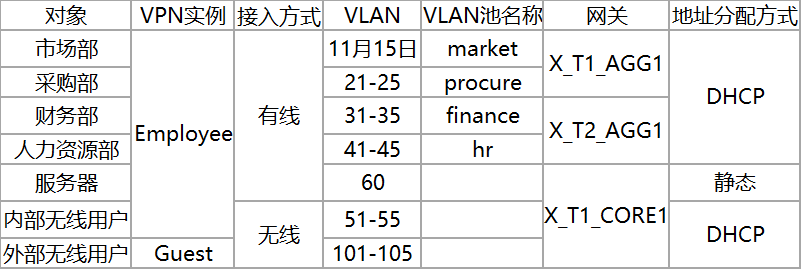

> 说明：原考试共7个需求，原来的需求一为配置可靠性，包括堆叠、链路聚合等，现已改为预配，无需关心，包括互联vlan201-209也已预配。
## 需求一：基础业务互联需求
1、根据所在部门、接入方式、终端类型等因素将终端用户划分成7类对象。参考表1-1《X 市园区终端接入规划表》
- a、市场部、采购部用户从X_T1_ACC1和X_T1_ACC2的G0/0/1-G0/0/20 接入网络，财务部人力资源部用户从X_T2_ACC1和X_T2_ACC2的GO/0/1-G0/0/20 接入网络。
- b、除服务器外，其他所有用户均通过 DHCP 获取IP地址与网关地址信息，X_T1_CORE1设备为 DHCP 服务器(已完成所有 DHCP 地址池创建)。	
- c、网关设备均以VLANIF接口作为用户网关，IP地址为10.1.X.254/24,为用户所在VLAN。

2、根据已有设备配置并结合《X市园区网络设备互联规划表》中的内容完成设备互联配置
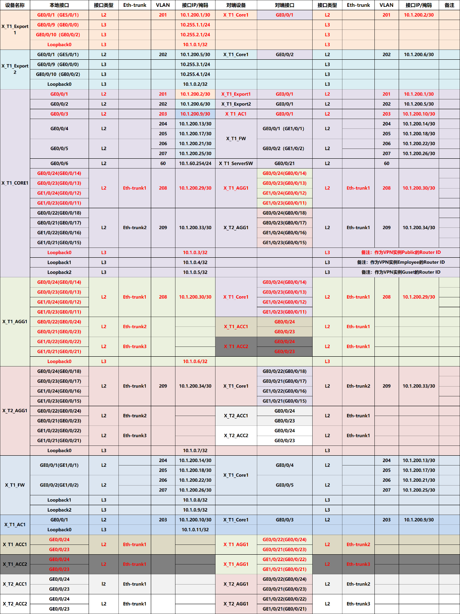

3、所有三层设备之间部署多区域OSPF
- a、两台出口路由器和核心交换机之间的链路属于骨干区域，终端用户访问 Internet 流量由两台出口路由器共同分担。
- b、根据网络隔离需求，将内部网络与访客网络分别划分到 OSPF 区域 1与区域 2 。
表 1-1X 市园区终端接入规划表:

## 需求二：网络隔离需求
1、在X_T1_CORE1上通过部署两个VPN实例，实现内部访问网络隔离
- a、实例名称分别为Employee与Guest，RD分别为65001:1和65001:2。
- b、表1-1中外部无线用户属于Guest，其他所有终端用户与相应网络设备接口属于Employee。	

2、防火墙X_T1_FW1使用虚拟系统与X_T1_CORE1上两个VPN实例Guest和Employee进行对接。
- a、虚拟系统名称和其对接的VPN实例名称保持一致。
- b、VLAN204与VLAN206分配给虚拟系统 Employee、VLANIF204属于untrust安全域，VLANIF206属于 trust 安全域，VLAN205与VLAN207分配给虚拟系统 Guest，VLANIF205属于untrust安全域， VLANIF207属于trust安全域。
- c、虚拟系统Employee与虚拟系统Guest和X_T1_CORE1之间的所有链路分别属于OSPF的区域1和区域2。
- d、使用IP-Prefix作为过滤器进行路由过滤，Employee与Guest之间不学习对方终端所在网段的明细路由与对应的3类LSA。

3、在不使用策略路由的前提下，跨OSPF区域的流量必须经过

## 需求三：WLAN扩容需求
1、X_T1_AP1已经在AC上线且正常提供无线服务X_T1_AP1和X_T2_AP1在相同管理VLAN上线并提供相同的无线服务，即延续当前的WLAN相关配置
- a、内部无线用户使用的SSID为X_Employee_001(010)，密码为Huawei@123。
- b、外部无线用户使用的SSID为X_Guest_001(010)，密码为Huawei@123。	

2、当前网络分别为内部与外部无线用户预留10.1.51.0/24(VLAN51)与10.1.101.0/24(VLAN101)，经常出现由于DHCP服务器可用地址不足导致用户无法正常接入无线网络的情况。现需要根据表1-1扩充可用地址数量，同时还需尽量保证同一用户接入网络时，IP地址不发生改变。

## 需求四：出口网络需求
1、新增出口路由器X_T1_Export2，采用双Internet线路实现上网流量的负载分担
- a、GE0/0/9(G0/0/0)接口采用静态配置IP地址(10.255.3.1/24)，网关为10.255.3.254。
- b、GE0/0/10(G0/0/2)接口采用静态配置IP地址(10.255.4.1/24)，网关为10.255.4.254。

2、所有用户通过X_T1_Export2路由器访问Internet时，需要通过NAT替换私网IP地址。
- a、对所有通过防火墙策略的IP报文进行源地址与端口转换。
- b、Export2的GEO/0/9(GO/0/0)使用当前接口IP地址作为转换后的地址。
- c、Export2的GE0/0/10(G0/0/2)使用地址池(10.255.4.2-10.255.4.100)替换私网IP地址和端口。
- d、X园区内网服务器(10.1.60.101) 向外提供WEB服务(端口号 80)，公网用户通过10.255.4.1的8081号端口访问该服务。

## 需求五：准入认证
1、为保证“端到端”网络安全，需要对除服务器外的有线终端进行认证。
- a、有线终端中，PC支持802.1X认证，打印机及IP电话等哑终端不支持，已知当前采用的接入交换机不支持802.1X认证与策略链路功能。
- b、汇聚交换机与认证服务器之间用RADIUS协议进行交互，服务器地址为10.1.60.2，使用默认等口号进行认证、授权和计费，密钥为Huawei@123。
- c、所有涉及到模板等均命名为 Employee。
- d、认证域为 Employee，且不允许用户使用其他域。
- e、RADIUS服务器通过VLAN池名称方式下发用户的VLAN地址，VLAN池名称参考表 1-1。

2、对于所有AP设备。需要根据AP的MAC地址，强制其到ap-noauthen域进行认证，且该域的认证方式为 none。

3、用户信息对应的授权信息已在认证与授权服务器上做配置，考生无需关心。用户名密码信息: hr Huawei@123、market Huawei@123、procureHuawei@123、finance Huawei@123。

## 需求六：网络安全需求

1、防火墙上配置安全策略实现用户访问权限的控制。
- a、仅采购部、市场部、内部无线用户、外部无线用户可以访问Internet。
- b、内部无线用户仅可以访问服务器网段的某一服务器，其IP地址为 10.1.60.100。
- c、外部无线用户仅可以访问服务器网段中的HTTP服务(服务名为Guest_Service)，IP地址为10.1.60.99，端口号为3389 (TCP)。

2、安全策略需按照下列规则配置
- a、必须包含源、目安全区域。
- b、若包含特定服务，需使用系统预定义服务或自定义服务(service-set) 表示。

3、外部无线用户访问Guest_Service服务的流量需要直接在Guest和Employee两个虚拟系统之间转发
- a、Guest和 Employee两个虚拟系统的Virtual-if属于untrust安全域，IP地址分别为10.1.200.254/32与10.1.200.253/32。
- b、仅当外部无线用户访问10.1.60.99时，流量直接在虚拟系统之间转发。

# 2、云管理园区与分支互联网新建
>说明：这个部分也叫Y园区，无法通过模拟器模拟，请尽量通过咸鱼租赁机架进行操作，Y园区大部分操作为web界面点击下发配置，命令行配置内容较少。

## 需求一：出口网管开局
1、Y市园区与试点门店均作为一个独立的站点管理，站点名称分别为 Site_Y 与 Site_Store1，两台路由器通过CLI手工配置的方式被控制器纳管	

2、根据表 2-1《WAN侧基础网络规划表》中的内容，通过WLAN链路模板对两个站点的WAN侧网络进行开局
表 2-1《WAN侧基础网络规划表》
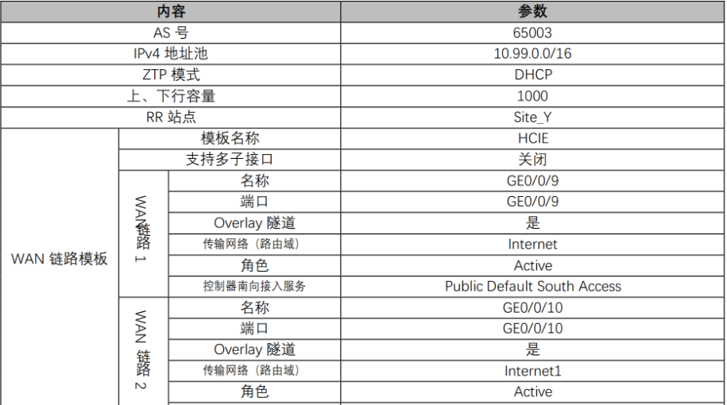

## 需求二：Y市园区内部设备纳管
1、所有网络设备通过 DHCP 方式获取控制器信息，并通过虚拟网络 Management 连接到Internet	
2、未完善

## 需求三：Y市园区一网多用
1、已知接入交换机不支持VXLAN 且所有终端网关需设置在Y_CORE1 上，请结合2-2《Y 市园区Fabric 与资源池规划表》中的信息完成Fabric 创建

2、划分三个逻辑网络，名称分别为 RD（包含研发部与生产部）、OA（包含市场部、财务部与内部无线用户）、Guest（包含访客用户）
- a、三个逻辑网络对应的终端规划，参考表 2-3《Y 市园区终端接入规划表》2）三个逻辑网络的终端均采用DHCP方式获取地址，参考表 2-4《Y 市园区服务资源规划表》（DHCP 服务器已预配置，考生无需操作）
- b、三个逻辑网络可以访问的外部网络资源不同且无法共享，参考表 2-5《Y 市园区外部网络规划表 1》、表 2-6《Y 市园区外部网络规划表 2》、表2-7《Y 市园区外部网络规划表 3》
- c、表 2-2 《Y 市园区 Fabric 与资源池规划表》
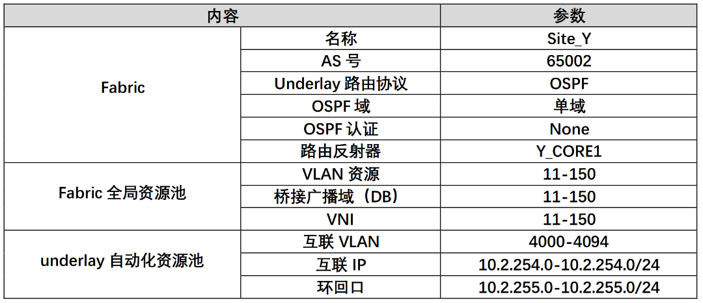
- d、表 2-3《Y 市园区终端接入规划表》
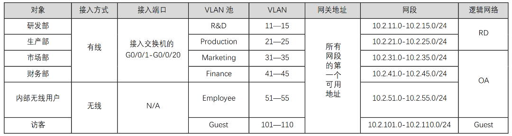
- e、表 2-4《Y 市园区服务资源规划表》
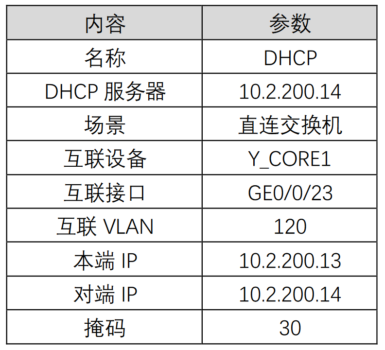

- f、表2-5《Y 市园区外部网络规划表 1》
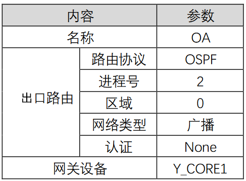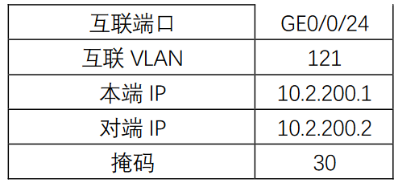

- g、表 2-6《Y 市园区外部网络规划表 2》
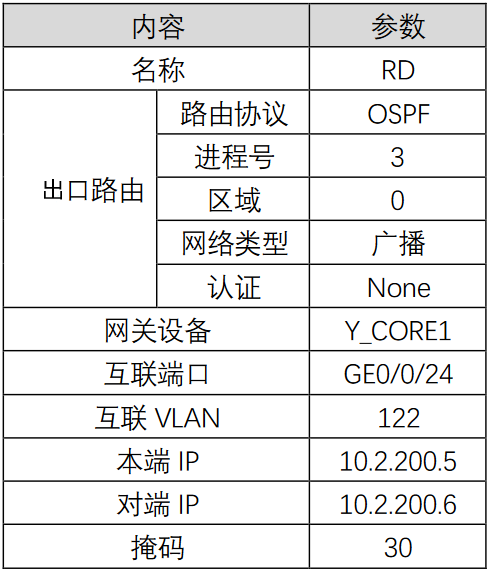
- h、表2-7《Y 市园区外部网络规划表 3》
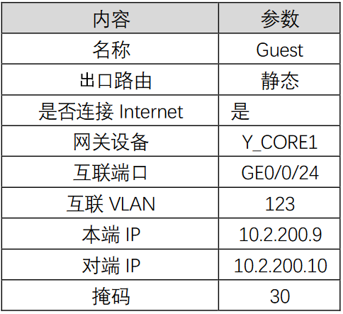

## 需求四：Y市园区业务随行
1、为了保证用户在网络任意位置接入时获得相同的网络访问策略，故对所有的用户做如下安全组划分
- a、Employee_RD1 与Employee_RD2 安全组，分别对应生产部与研发部的用户
- b、Employee_OA1 安全组，对应市场部、财务部用户和内部无线用户
- c、Guest 安全组，对应访客用户	

2、针对不同安全组用户，可访问的静态服务资源不同，资源组规划如下
- a、Service_RD1 对应 IP 网段为 10.3.99.0/24
- b、Service_RD2 对应 IP 网段为 10.3.100.0/24
- c、Service_Common 对应的IP 网段为 10.3.101.0/24

3、安全组、资源组之间的策略参考 《Y 市园区策略矩阵规划表》
- a、表 2-8《Y 市园区策略矩阵规划表》
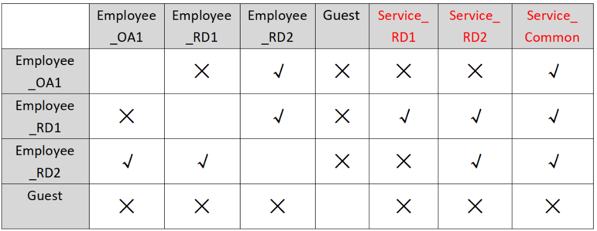

## 需求五：Y市园区用户准入认证
1、iMaster NCE-Campus 控制器作为 RADISU 服务器和 Portal 服务器，对所有的用户进行认证并在认证通过后下发安全组、vlan 组等授权信息

2、有线用户从 Y_ACC 1 与 Y_ACC2 的 GE0/0/1-GE0/0/20 接口接入网络，采用 802.1X 和 MAC 的混合认证；接入交换机作为认证执行点，汇聚交换机作为认证的控制点，策略联动管理 Vlan 为 124，IP 为 10.2.251.1/24 和 10.2.250.1/24

3、分别向内部无线用户与访客用户提供Wireless_Employee010 和 Wireless_Guest010 两个 SSID 的无线信号，并对用户无线用户使用 portal 认证，认证协议为 HACA

4、根据《Y 市园区认证用户表》完成准入用户与准入策略的创建，在配置授权规则时，应保证拥有大量用户情况下的可拓展性
- a、表 2-9《Y 市园区认证用户表》
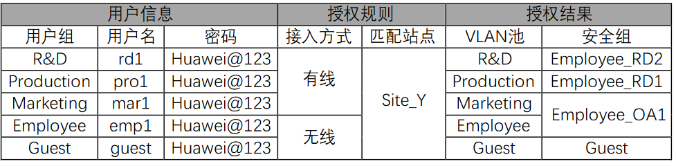

## 需求六：Y市园区与试点门店互通
1、试点门店内用户包括员工、订单管理系统终端与顾客，相互之间路由隔离，均由 Store1_Export1 地址且以其作为网关，具体规划见《试点门店 LAN 侧网络规划表》
- a、表 2-10《试点门店 LAN 侧网络规划表》
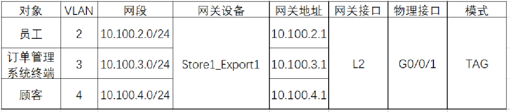

2、Y 市园区与试点门店通过 SD-WAN 虚拟网络实现广域互联
- a、WAN 侧逻辑拓扑选择 Hub-Spoke，Y_Export1 为分支互通的 Hub，互联隧道需要通过IPsec 加密
- b、门店员工所在网络通过 SD-WAN 虚拟网络Y_OA_To_Sites 与 Y 市园区 VXLAN 逻辑网络OA互通，且需要通过Y_Export1 访问 internet
- c、订单管理系统所在网络通过 SD-WAN 虚拟网络 Y_RD_To_Sites 与 Y 市园区 VXLAN 逻辑网络 RD 互通，无访问internet 需求

3、Y 园区 VXLAN 逻辑网络 Guest 与试点门店顾客通过 SD-WAN 虚拟网络 Guest_To_Internet 访问 internet
- a、WAN 侧逻辑拓扑使用 Full-Mesh，不使用 IPsec 加密
- b、访问 internet 的流量由各自的出口路由器直接转发，且优先使用传输网络Internet

# 3、广域承载网建设（MPLS）
>注意：一共两套试题，一套是MPLS建设广域承载网，另一套是SRV6建设广域承载网

## 需求一：配置广域骨干网Underlay
1、骨干网络Underlay通过IS-IS协议实现互通，所有骨干网设备之间只需要建立IS-IS邻居。

2、在设置IS-IS路由级别、Cost类型与接口类型的参数时，需要保证所有IS-IS路由器都运行在骨干区域，且能适应大规模网络，也需要保证IS-IS路由器能快速建立邻居关系(需求在2S内建立邻居)。

3、IS-IS地址需要基于设备的Router ID地址形成(比如 Router ID 1.0.0.1对应的SystemID为0010.0000.0001)，NET地址AreaID统一为49.0001。

~~4、为了保证IS-IS网络的安全，在形成邻居及交互LSP时需要配置MD5认证，认证密码为Huawei@123。~~
>该需求已删除

5、IS-IS网络在发生故障时，能够快速感知邻居中断，且需要保证在部分节点或链路故障时流量的中断时间都能小于50ms。

6、由于PE设备之间的链路租用的是运营商线路，带宽较小，所以在配置IS-IS Cost值时需要保证流量同平台优先在本平面基于最短路径转发，如果转发失败，备份路径优先在PE上跨平台转发，以Y_PE1去往Z_PE1的流量路径为例。

## 需求二：部署广域骨干网MPLS
1、骨干网使用LDP构建MPLS-LSP。

2、为了保障网络可靠性，需要能端到端(PE到PE)的检查MPLS LSP的连通性，并确保当MPLS主路径发生故障时，流量能在50ms内切换到备路径。

3、请确保当MPLS主路径上的链路恢复后，备用路径回切时，不会产生大量丢包。

## 需求三：部署广域骨干网VPN
1、X园区内有Employee业务，Y园区内有OA管理业务和R&D管理业务，数据中心内有OA后台业务与R&D后台业务，门店内有Employee业务与订单管理业务。 

2、整网业务被分成两大类，两大类业务流量需要端到端(即园区不同业务之间) 隔离，这两大类业务的基本规划如下。
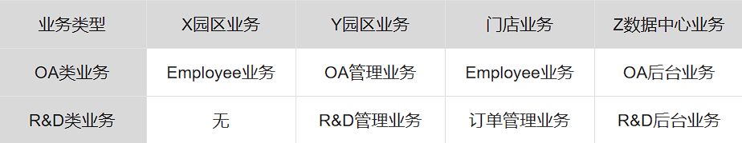
- a、OA类业务：X园区、门店的及Y园区的OA可以与Z数据中心的OA类业务互通，X园区可以与Y园区以及门店互通，但流量必须绕行Z市数据中心的CE设备(Z_Export1)。
- b、R&D类业务：门店与Y园区的R&D业务可与Z数据中心的R&D类业务互通。
- c、门店的OA类业务与R&D类业务先通过SD-WAN网络将流量发往Y_Export1，然后再通过Y_Export1 将数据发往Z市数据中心。

3、所有 PE 设备(即骨干网)都属于 AS 65000，PE之间使用 BGP VPNv4 传递路由，X_PE1与X_PE2两台 PE 设备做为同级RR 为全网反射 VPN 路由，配置RR 时需要考虑 BGP 路由更新效率和可靠性。(注意 Y_PE1与Z_PE之间无需建立 BGP VPNv4 邻居)。

4、为了保障BGP邻居的安全性，请只在必要的PE之间建立BGP VPNv4邻居。

5、PE侧VPN实例已经预配，预配规划如下。
- a、接口（红色为ENSP模拟使用，可以忽略）
- b、请根据OA类与R&D类业务需求，规划并配置VPN实例的RD与RT。
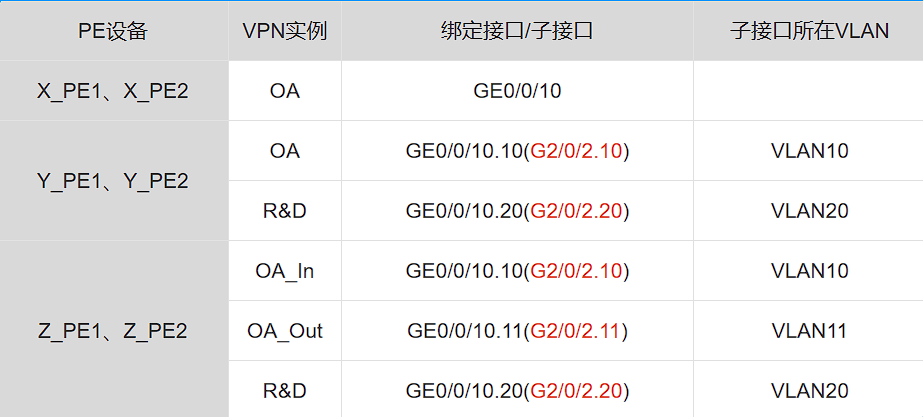

6、CE与PE互联的地址未配置，请基于以下地址规划配置
- a、接口(标红为ENSP)
- b、配置CE与PE的互联接口时，需要保证业务能端到端隔离。
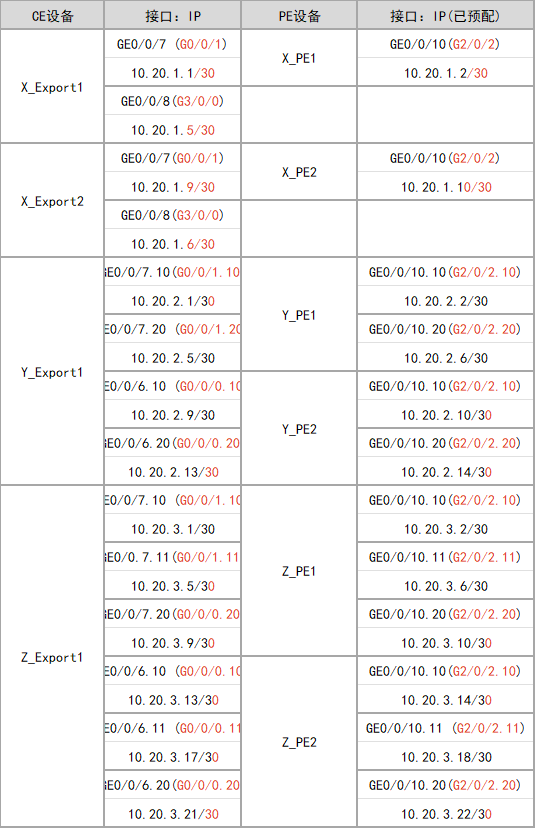

7、X园区、Y园区、门店的OA类与R&D类业务的网段可查看《传统园区改造与升级》与《云管理园区与分支互联网络新建》项目，Z数据中心LAN侧业务网段未配置，请根据规划部署。
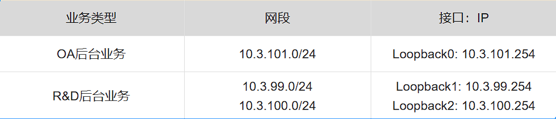

8、CE与PE之间使用BGP协议传递路由，其中X园区出口所在AS为65001,Y园区出口所在AS为65003，Z数据中心出口所在园区为65004。

9、骨干网上的流量统一通过MPLS隧道承载，具体规划如下。
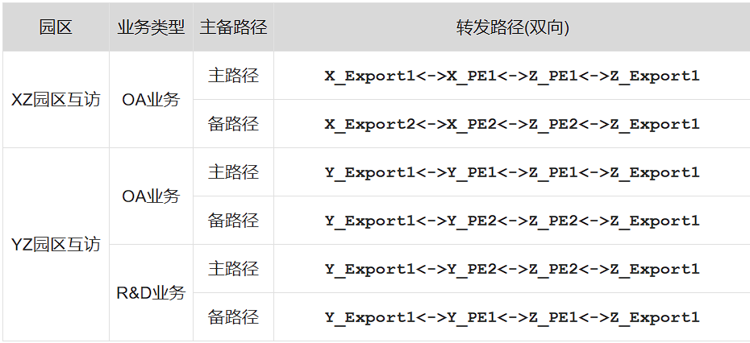

10、X园区与Y园区，LAN侧使用OSPF打通内部网络，X与Y园区的LAN侧网络需要能够基于从BGP继承来的Cost值选择主备路径,Z数据中心的LAN侧网络为直连网络无需部署OSPF。

11、为了提高X园区可靠性在X_Export1与X_Export2之间也需要部署OSPF，注意不要产生环路和次优。

12、为了增强OA类业务的可靠性，需保证当Z_PE1出现故障，发往Z园区的OA类流量能迅速发往Z_PE2。

13、PE之间的链路使用了运营商的传输专线，运营商告知传输专线(即不同园区PE之间互联链路)的L2 MTU值为1400，请设置合理的MPLS MTU值，保证企业园区之间以最高效率传递大包。同时报文不会被丢弃(不考虑Qos的影响)。

# 3、广域承载网建设（SRV6）
>注意：一共两套试题，一套是MPLS建设广域承载网，另一套是SRV6建设广域承载网

## 需求一：配置广域骨干网Underlay
1、骨干网络Underlay通过IS-IS协议实现互通，所有骨干网设备之间只需要建立IS-IS IPv6 邻居。

2、在设置IS-IS路由级别、Cost类型与接口类型的参数时，需要保证所有IS-IS路由器都运行在骨干区域，且能适应大规模网络，也需要保证IS-IS路由器能快速建立邻居关系(需求在2S内建立邻居)。

3、IS-IS NET 地址需要基于设备的Router ID地址形成(比如Router ID 1.0.0.1对应的SystemID为0010.0000.0001)，NET地址AreaID统一为49.0001。

4、为了保证IS-IS网络的安全，在形成邻居及交互LSP时需要配置MD5认证，认证密码为Huawei@123。

5、IS-IS网络在发生故障时，能够快速感知邻居中断，且需要保证在任意节点或链路故障时流量的中断时间都能小于50ms。

6、由于PE设备之间的链路租用的是运营商线路，带宽较小，所以在配置IS-IS Cost值时需要保证流量同平台优先在本平面基于最短路径转发，如果该路径失效，备份路径优先在PE上跨平台转发，以Y_PE1去往Z_PE1的流量路径为例。
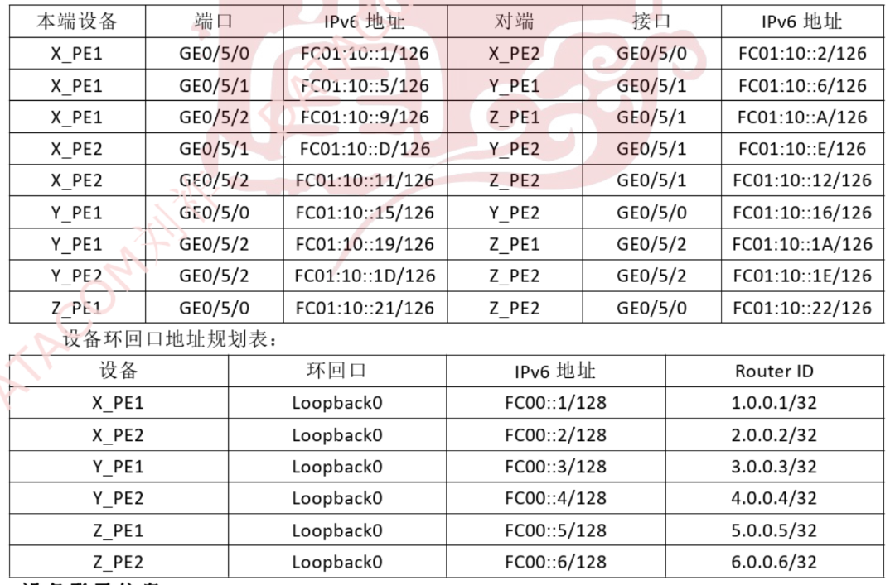

## 需求二：部署广域骨干网SRV6
1、由于广域骨干网规模不大，公司决定不采购 iMaster NCE-IP 控制器，在没有控制器的情况下部署 SRv6 Policy，广域骨干网上的流量使用 SRvs Policy 承载。
- a、关于 SRv6 Locator 的配置请基于一下规划部署
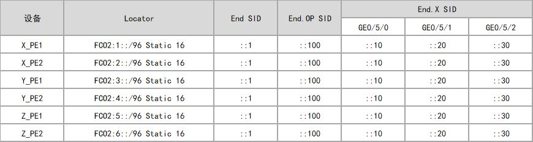
- b、SRv6 Policy 隧道配置基于规划部署，部署时需要使用严格显示路径的方式部署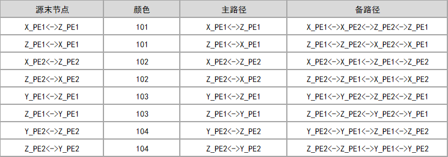
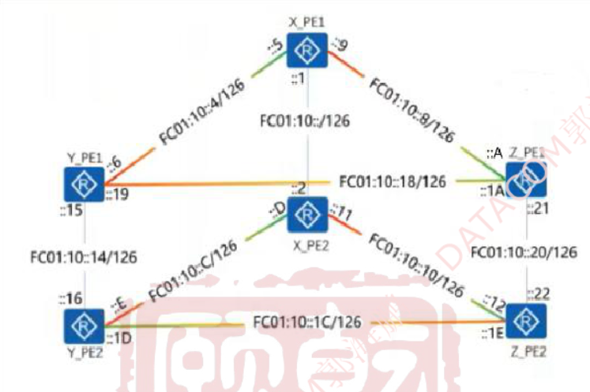
- c、为了保障 SRv6 Policy 隧道可靠性，当主路径的中间节点或链路发生故障时(即源节点与目标节点正常)，源节点能在 200ms 内将流量切换到备路径。

## 需求三：部署广域骨干网VPN
1、X园区内有Employee业务，Y园区内有OA管理业务和R&D管理业务，数据中心内有OA后台业务与R&D后台业务，门店内有Employee业务与订单管理业务。 

2、整网业务被分成两大类，两大类业务流量需要端到端(即园区不同业务之间) 隔离，这两大类业务的基本规划如下。
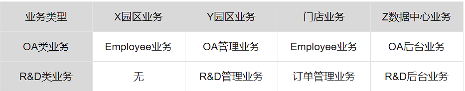
- a、OA类业务：X园区、门店的及Y园区的OA可以与Z数据中心的OA类业务互通，X园区可以与Y园区以及门店互通，但是X园区的OA类业务不能与Y园区和门店的OA类业务互相通信。
- b、R&D类业务：门店与Y园区的R&D业务可与Z数据中心的R&D类业务互通。
- c、门店的OA类业务与R&D类业务先通过SD-WAN网络将流量发往Y_Export1，然后再通过Y_Export1 将数据发往Z市数据中心。
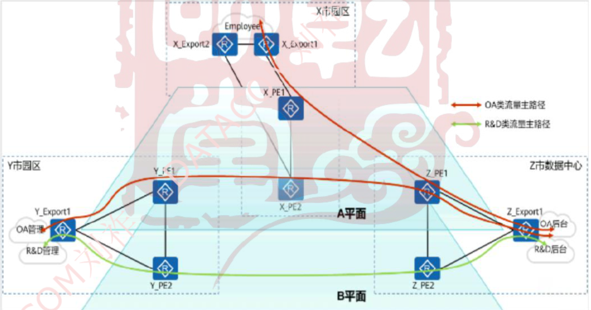

3、所有 PE 设备(即骨干网)都属于 AS65000，PE 之间使用 BGP EVPN 传递路由，由于网络规模较小，PE 之间直接建立 BGP 邻居，不需要部署 RR。注意，只需要在必要的 PE 之间建立BGP EVPN 邻居。

4、PE侧VPN实例已经预配，预配规划如下。
- a、请根据OA类与R&D类业务需求，规划并配置VPN实例的RD与RT。
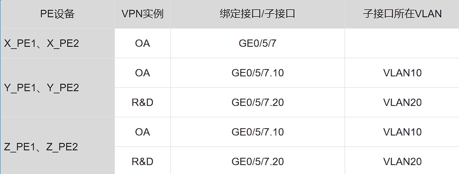

5、CE与PE互联的地址未配置，请基于以下地址规划配置
- a、配置CE与PE的互联接口时，需要保证业务能端到端隔离。
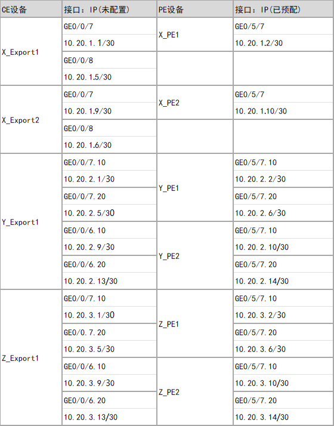

6、X园区、Y园区、门店的OA类与R&D类业务的网段可查看《传统园区改造与升级》与《云管理园区与分支互联网络新建》项目，Z数据中心LAN侧业务网段未配置，请根据规划部署。
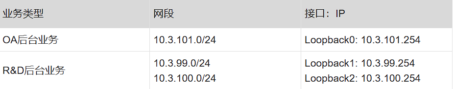

7、CE与PE之间使用BGP协议传递路由，其中X园区出口所在AS为65001,Y园区出口所在AS为65003，Z数据中心出口所在园区为65004。
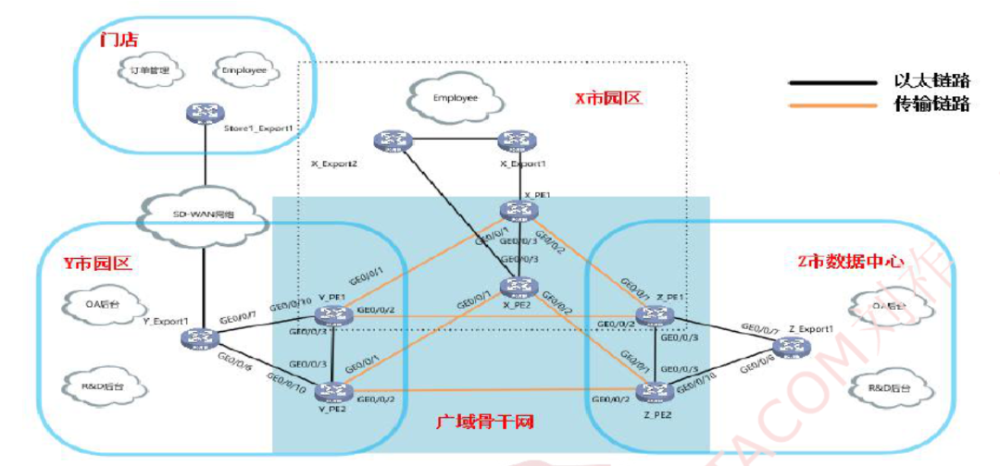

8、广域骨干网上的流量统一通过 SRv6 隧道承载，具体规划如下
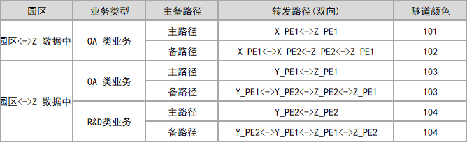

9、当规划的 SRv6 路径失效时，骨于网需要依然能够转发流量，此时流量可以不根据规划的路径转发。

10、X园区与Y园区，LAN侧使用OSPF打通内部网络，X与Y园区的LAN侧网络需要能够基于从BGP继承来的Cost值选择主备路径,Z数据中心的LAN侧网络为直连网络无需部署OSPF。

11、为了提高X园区可靠性在X_Export1与X_Export2之间也需要部署OSPF，注意不要产生环路和次优。

# 4、编程自动化（MPLS）
>注意：这部分与骨干网有关，如果是MPLS则编程是巡检X_T1_AGG1;
如果是SRV6则编程是netconf

1、定期对X园区X_T1_AGG1 的关键运行状况进行监控 (5min)
- 电源状态。
- 风扇状态
- LACP状态
- CPU、内存利用率
- OSPF邻居状态
  
2、terminal 01与X_T1_AGG1的环回口(10.1.0.6/32)建立较为安全的管理

3、对状态监控结果进行分析，并在风扇出现异常状态时（两个风扇状态全部为非normal）

4、脚本所执行的监控相关命令不直接在代码中固定，而是以文件形式保存，脚本从文件中读取命令并执行

5、代码应有较好的层级结构以及复用率，应使用类、函数来构建上述功能，编写以上脚本你可能用到 paramiko nccilent、time、datatime等python编译环境以及所需的运行库或者第三方库已经在Terminal 01上安装完成，请在Terminal 01 上完成上述脚本

6、在terminal 01上使用python编译环境编译，然后将编译好的代码在编译器上右键选择“run”，把自动化输出的结果保存到txt 

# 4、编程自动化（SRV6）
>注意：这部分与骨干网有关，如果是MPLS则编程是巡检X_T1_AGG1;
如果是SRV6则编程是netconf

1、每隔24h保存一次X_T1_AGG的配置文件，并通过安全的文件传输协议将配置文件备份在电脑本地，以[当天日_设备名称]的名称命名，设备端以及本地的配置文件如2021_10_20_X_T1_AGG1.zip,2021 _10_20_X_T1_AGG1.bak 

2、terminal 01与X_T1_AGG1的环回口(10.1.0.6/32)建立较为安全的管理

3、脚本所执行的监控相关命令不直接在代码中固定，而是以文件形式保存，脚本从文件中读取命令并执行

4、代码应有较好的层级结构以及复用率，应使用类、函数来构建上述功能，编写以上脚本你可能用到 paramiko nccilent、time、datatime等python编译环境以及所需的运行库或者第三方库已经在Terminal 01上安装完成，请在Terminal 01 上完成上述脚本

5、在terminal 01上使用python编译环境编译，然后将编译好的代码在编译器上右键选择“run”，把自动化输出的结果保存到txt 